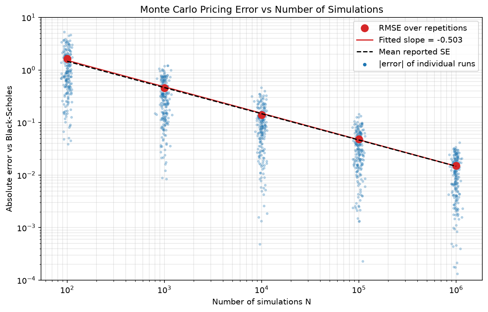
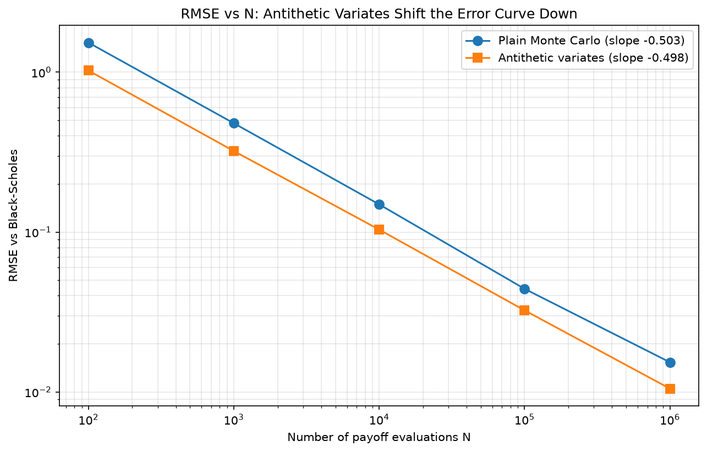

# Stochastic Modelling and Monte Carlo Methods for Financial Markets

A step-by-step project that starts with a coin-flip random walk and ends with a variance-reduced Monte Carlo option pricer. Each step is checked against its analytical counterpart.

Each notebook introduces one idea, derives what theory predicts, simulates it, and verifies that simulation and theory agree (every notebook ends with automated consistency checks).

## Roadmap

| # | Notebook | Topics |
|---|---|---|
| 1 | [Random Walks](notebooks/01_random_walks.ipynb) | Symmetric walk, $\mathrm{Var}(S_t)=t$, drift vs noise, Donsker scaling to Brownian motion, quadratic variation |
| 2 | [Geometric Brownian Motion](notebooks/02_geometric_brownian_motion.ipynb) | $dS_t=\mu S_t\,dt+\sigma S_t\,dW_t$, Itô solution, exact simulation, log returns, lognormal terminal law, effect of $\mu$, $\sigma$, $T$ |
| 3 | [Monte Carlo Estimation](notebooks/03_monte_carlo_estimation.ipynb) | Terminal distributions, expected payoffs, standard errors and CIs, sampling distribution of the estimator, $O(1/\sqrt N)$ convergence |
| 4 | [European Option Pricing](notebooks/04_european_option_pricing.ipynb) | Risk-neutral measure ($r$ instead of $\mu$), discounted expected payoff, Black–Scholes comparison, put–call parity, pricing across strikes |
| 5 | [Convergence Analysis](notebooks/05_convergence_analysis.ipynb) | $N=10^2\ldots10^7$, error vs Black–Scholes, empirical rate, CI coverage, cost of accuracy |
| 6 | [Variance Reduction](notebooks/06_variance_reduction.ipynb) | Antithetic variates: unbiasedness, $1/(1+\rho)$ variance reduction, when it helps and when it hurts |

## Key results

ATM European call, $S_0=K=100$, $r=5\%$, $\sigma=20\%$, $T=1$; Black–Scholes price **10.4506**.

**Monte Carlo converges at rate $N^{-1/2}$.** Across 200 repetitions per sample size the fitted slope of RMSE vs $N$ is −0.50. Each run's own standard error matches the true error, and from $N=10^3$ upward, 95% confidence intervals cover the Black–Scholes price about 95% of the time.



**Antithetic variates keep the rate but lower the constant.** Pairing $Z$ with $-Z$ halves the variance for the ATM call ($\rho\approx-0.5$) and gives factors of 20–80 for deep in-the-money options. It makes things *worse* for non-monotone payoffs such as an at-the-money straddle.



## Project structure

```
stochastic-modelling-monte-carlo/
├── notebooks/          # the six-part narrative (executed, with outputs)
├── src/stochmc/        # reusable, tested implementation
│   ├── random_walk.py  #   simple and rescaled random walks
│   ├── gbm.py          #   exact GBM path / terminal simulation, moments
│   ├── black_scholes.py#   analytical European prices
│   └── monte_carlo.py  #   estimators, standard errors, CIs, MC pricer (+ antithetic)
├── tests/              # pytest suite for the package
└── figures/            # figures used in this README (generated by notebooks 5 and 6)
```

The early notebooks build each method by hand. Later notebooks import the same logic from `stochmc`, so the analysis stays readable and the core code is unit-tested.

## Running it

```bash
conda create -n quant-portfolio python=3.12
conda activate quant-portfolio
pip install -r requirements.txt

pytest                      # run the test suite
jupyter lab notebooks/      # open the notebooks
```

Run commands from this directory. The notebooks add `../src` to the import path themselves, so no package install is needed. All randomness is seeded (`SEED = 42`) for reproducibility.

## Assumptions and limitations

GBM assumes constant drift and volatility, independent increments and Gaussian log returns. Real markets show heavy tails, volatility clustering and jumps (see the [empirical returns analysis](../empirical-returns-analysis/) in this repository). The aim of this project is the Monte Carlo methodology, which carries over unchanged to richer models and to path-dependent payoffs without closed-form prices.
